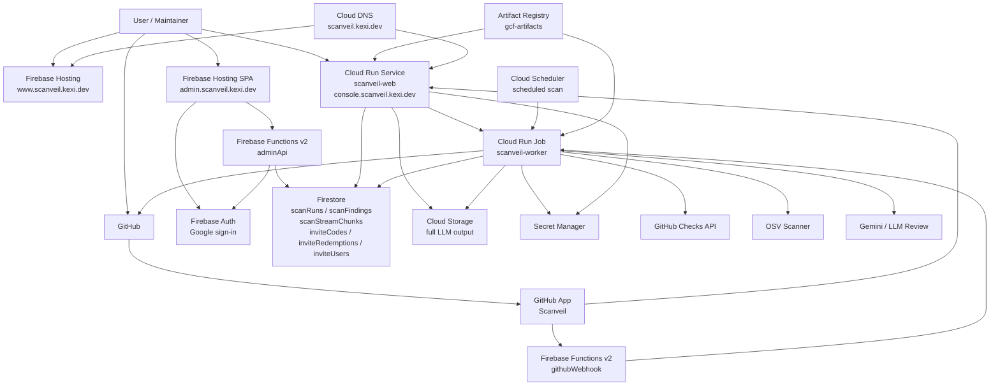

# Scanveil Infrastructure Architecture

This diagram captures the deployed Scanveil shape as code and documentation context for future agents and maintainers.

## Request Flow

1. Users install the GitHub App from the docs site.
2. GitHub sends webhook events through Firebase Hosting rewrite `/webhooks/github` to `githubWebhook`.
3. The webhook service validates the event and runs Cloud Run worker jobs with `SCAN_REQUEST_JSON`.
4. The Management Console lists GitHub App installations, repositories, and open pull requests.
5. The top-level Scan button enqueues installed repositories at their default branch head SHA.
6. The Management Console requires a currently enabled redeemed invite code before manual scans can be queued. Invite redemptions are keyed by GitHub user ID. Disabled users and users whose redeemed invite code was paused or deleted are blocked server-side, including a second check immediately before a manual scan is enqueued.
7. Cloud Scheduler can run the worker without `SCAN_REQUEST_JSON`; the worker then enumerates installed repositories and creates scheduled repository-wide scans.
8. Workers read repository config from `.scanveil/config.yml` with `.scanveil.yml` migration fallback, inspect pull request diffs for PR scans, inspect bounded default-branch source snapshots and lockfiles for repository-wide scans, then publish GitHub Checks.
9. The same `scanveil-worker` job runs OSV scanning and LLM review. OSV findings, LLM findings, SVE IDs, duplicate metadata, usage, cost, and stream metadata are persisted as one scan run.

## Admin Flow

The operator admin site is a separate Firebase Hosting static SPA at `https://admin.scanveil.kexi.dev/`. It uses Firebase Auth Google sign-in and accepts only `kei.of.nakayama@gmail.com` in the client and in the `adminApi` Firebase Function. The admin API verifies Firebase ID tokens with Firebase Admin SDK before reading or writing Firestore.

The admin site manages:

- `inviteCodes`: reusable invite codes with a display name, enabled flag, usage limit, and redemption count.
- `inviteRedemptions`: audit records showing which GitHub account used which code.
- `inviteUsers`: GitHub accounts seen by the console, including disabled/enabled status, registration timestamp, login counters, latest login timestamp, manual scan run count, queued scan request count, and latest scan timestamp.

The admin Hosting site serves a domain-local `robots.txt` with `Disallow: /`. The docs Hosting site also disallows the legacy `/admin` and `/admin/api/` paths.

## Scan Result and Stream Flow

The worker persists scan results with a split-store model:

- `scanRuns`: one execution record keyed by delivery ID, including repository, reason, status, finding counts, LLM provider/model, token usage, estimated cost, Vertex AI location, Cloud Run runner region, stream chunk count, and full LLM output path when available.
- `scanFindings`: normalized OSV and LLM findings, including source, severity, aliases, location, evidence, recommendation, SVE-ID metadata, duplicate/suppression state, normalized text, optional embedding, and code span fingerprint.
- `scanStreamChunks`: short ordered UI chunks from active LLM output keyed by delivery ID and sequence.
- Cloud Storage: durable full LLM output at `scan-runs/{deliveryId}/llm-output.txt`.

Firestore is used for indexed metadata and small near-real-time chunks. Cloud Storage is the source of truth for full LLM output because Firestore documents have a 1 MiB limit. The Management Console exposes `GET /api/scans/:deliveryId/stream` as server-sent events and wraps it with TanStack Query `experimental_streamedQuery` on the client. Completed full output is fetched through the Console server from Cloud Storage, keeping storage access behind the authenticated session.

Scan Details shows both OSV and LLM findings. Scan History shows all findings available for each scan, including known findings, and marks findings that first appeared in that scan with a `new` badge. SVE detail pages provide copy-to-clipboard text intended for use in Codex or Antigravity CLI follow-up work.

## Domain Mapping

- Docs: `https://www.scanveil.kexi.dev/`
- Operator Admin: `https://admin.scanveil.kexi.dev/`
- Management Console: `https://console.scanveil.kexi.dev/login`
- Webhook rewrite: `https://www.scanveil.kexi.dev/webhooks/github`

## Deployment Units

- `apps/docs`: Vite React static docs and operator admin SPA deployed to Firebase Hosting.
- `apps/functions`: Firebase Functions v2 webhook backend and admin API.
- `apps/console`: Vite React console with a `tsdown` Node server deployed to Cloud Run.
- `apps/worker`: Cloud Run Job scan worker.
- `infra/terraform`: GCP infrastructure, DNS, Cloud Run, Firestore, IAM, and Secret Manager wiring.

## Persistence

Terraform enables Firestore by default. If the worker is enabled, Firestore is forced on because repository and pull request scans write execution state to `scanRuns`, finding details to `scanFindings`, and short LLM output chunks to `scanStreamChunks`. Full LLM output is stored in Cloud Storage when `SECURITY_APP_SCAN_ARTIFACT_BUCKET` is configured. Invite gating uses `inviteCodes`, `inviteRedemptions`, and `inviteUsers` in the same Firestore database so the Management Console can block manual scan starts without adding a separate database product. Invite code redemption validates the embedded check digit before any Firestore read, while scan start validates the user's stored redemption against the current `inviteCodes` record so paused codes stop future scans.

## Cloud Run Job Invocation

The webhook service, Management Console, and scheduled scan path run the worker through the Cloud Run Jobs v2 `:run` API. Manual and pull request scans inject `SCAN_REQUEST_JSON` with container overrides, so callers require `run.jobs.runWithOverrides`. `roles/run.developer` includes that permission; `roles/run.invoker` only includes `run.jobs.run` and is not sufficient for the current worker contract.

## Runtime IAM Shape

Terraform splits runtime identities by trust boundary instead of sharing one broad service account. Cloud Run API, Cloud Run web, Cloud Run worker, Firebase webhook, Firebase admin, and Cloud Scheduler each use separate service accounts. Secret Manager access is granted per secret, Firestore access is granted only to runtimes that read or write persisted state, and worker job execution uses a narrow custom role for override callers while Scheduler keeps `roles/run.invoker`.
