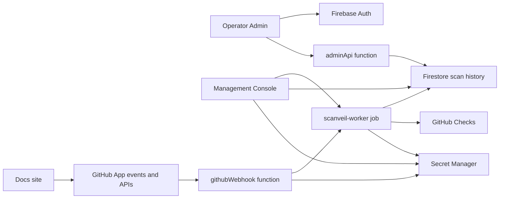

# Scanveil System Overview

Scanveil is a GitHub App security scanning PoC that runs on Google Cloud. It scans pull requests and installed repositories with OSV and LLM-backed review, suppresses duplicate findings, and publishes results back to GitHub Checks.

## Product Surfaces

| Surface            | Runtime                                           | Purpose                                                                      |
| ------------------ | ------------------------------------------------- | ---------------------------------------------------------------------------- |
| Docs               | Vite React static site                            | Public setup guide, `.scanveil/config.yml` documentation, and public schema. |
| Operator Admin     | Firebase Hosting SPA at `admin.scanveil.kexi.dev` | Invite code, usage history, and user access administration.                  |
| Management Console | Vite React client and Node HTTP                   | Authenticated GitHub App installation, repository, and scan operations.      |
| GitHub App         | GitHub installation                               | Grants repository access, receives events, and publishes Checks.             |
| Webhook backend    | Firebase Functions v2                             | Receives GitHub webhook events from Firebase Hosting rewrite.                |
| Scan worker        | Cloud Run Job                                     | Executes repository and pull request scans.                                  |

## Runtime Flow

1. A user installs the Scanveil GitHub App from the docs site.
2. GitHub sends webhook events to `/webhooks/github`.
3. Firebase Hosting rewrites the request to the `githubWebhook` Firebase Function.
4. The webhook validates the event and runs the scan worker Cloud Run Job with `SCAN_REQUEST_JSON`.
5. The Management Console can also enqueue repository-wide scans manually.
6. Manual scan enqueue requires a redeemed invite code. Invite redemption is one-time per GitHub account, but each invite code can be reused until its configured limit is reached.
7. Cloud Scheduler can run the worker without `SCAN_REQUEST_JSON`; the worker then enumerates installed repositories and creates scheduled repository-wide scan requests.
8. The scan worker reads `.scanveil/config.yml` with `.scanveil.yml` migration fallback, runs enabled scanners, suppresses duplicates, records history, and updates GitHub Checks when the installation has Checks write permission.

## Data Flow

## Persistent Data

Firestore is the persistent database for scan execution history, finding details, and invite access control. Terraform enables Firestore by default, and worker deployments force Firestore resources and runtime `roles/datastore.user` IAM because the scan worker writes `scanRuns` and `scanFindings` during every persisted scan. `scanRuns` records include the LLM provider, model, Vertex AI location, Cloud Run runner region, token usage, and estimated USD cost when an LLM review runs and token prices are configured. `scanFindings` records include SVE-ID metadata and, when duplicate suppression is enabled, finding embeddings used for repository-scoped similarity matching. Invite access uses `inviteCodes`, `inviteRedemptions`, and `inviteUsers`; the Management Console blocks scan starts for users without a redemption or with disabled status. The Management Console reads scan history through its server API and keeps the Scan History view current with TanStack Query plus a server-sent events stream.

Secrets such as GitHub App credentials, OAuth credentials, webhook secrets, session secrets, and scanner credentials are stored in Secret Manager or local `.env` files for development. Do not commit secret values.

## Repository Layout

| Path                | Role                                                                   |
| ------------------- | ---------------------------------------------------------------------- |
| `apps/docs`         | Vite React static docs, public schema, icons, and social preview.      |
| `apps/console`      | Vite React Management Console and Node server deployed to Cloud Run.   |
| `apps/functions`    | Firebase Functions v2 webhook backend and operator admin API.          |
| `apps/api`          | Cloud Run-style webhook service package retained in the workspace.     |
| `apps/worker`       | Cloud Run Job scan worker.                                             |
| `packages/core`     | Shared config schemas, product metadata, logging, scan request types.  |
| `packages/github`   | GitHub App authentication, repository, pull request, and Checks APIs.  |
| `packages/scanners` | OSV and LLM scanner adapters.                                          |
| `packages/rag`      | Finding normalization and duplicate suppression helpers.               |
| `packages/auth`     | OAuth, signed session cookie, and session token helpers.               |
| `infra/terraform`   | GCP infrastructure, DNS, IAM, Cloud Run, Firebase, and secrets wiring. |
| `knowledge`         | OKF-style repository-local knowledge bundle.                           |

## Current Boundaries

- Repository-wide manual Scan targets installed repositories at their default branch head SHA.
- Pull request scans can include LLM diff review. Repository-wide scans include bounded source snapshot LLM review plus lockfile and configured repository checks.
- Pull request webhooks and Management Console manual scans both enqueue the same scan worker Cloud Run Job contract with `SCAN_REQUEST_JSON`.
- Scheduled worker runs without `SCAN_REQUEST_JSON` enumerate GitHub App installations and create repository-wide scan requests with `reason: scheduled`. A single repository failure is recorded and logged without stopping the remaining scheduled repositories.
- Scan executions are stored in `scanRuns`; finding details are stored in `scanFindings` and queried into Management Console history by `deliveryId`.
- SVE-ID is a repository-scoped finding identifier with the `SVE-YYYYMM-REPOHASH-FINDINGHASH` shape. Repeated similar findings in the same repository reuse the existing SVE-ID, while similar findings in different repositories receive repository-specific SVE-IDs.
- The Firestore-backed duplicate lookup first checks deterministic SVE fingerprints, then uses Firestore Vector Search over `scanFindings.embeddingVector` for repository-scoped semantic similarity. If the vector index is unavailable, the worker falls back to in-process cosine similarity over repository findings.
- If GitHub Checks creation is rejected with a 403, the worker logs `github_check_skipped` and still persists `scanRuns` / `scanFindings` so Console history remains available while GitHub App permissions are fixed.
- The Management Console is authenticated through GitHub OAuth session cookies and requires invite-code redemption before manual scan execution.
- Operator administration is separate from the Management Console. `https://admin.scanveil.kexi.dev/` uses Firebase Auth Google sign-in and only allows `kei.of.nakayama@gmail.com`; admin API calls verify Firebase ID tokens server-side.
